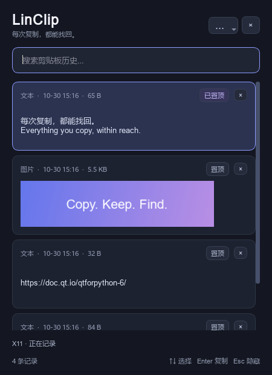

# LinClip

像 Windows **Win+V** 一样，为 Linux 保留剪贴板历史。Python + Qt 6，根据系统语言自动使用中文或英文界面，本机存储，无云同步。



界面离屏渲染示例；[查看英文界面](docs/screenshots/en_US.png)。截图用于展示布局，不代表 Linux 桌面实测结果。

## 功能

- 文本和 PNG 图片历史，重复内容合并并移到最近位置。
- 搜索、置顶、单条删除、清空，支持保留置顶项。
- 点击或 Enter 将记录复制到系统剪贴板，Esc 隐藏窗口。
- 托盘常驻、暂停记录、登录自启动、单实例运行。
- 启动时自动检测系统语言：中文 locale 使用中文，其他语言使用英文；尊重 `LANGUAGE`、`LC_ALL`、`LC_MESSAGES` 和 `LANG`，`C` / `POSIX` 使用英文。
- X11 下可选自动粘贴，支持普通应用和终端的两种粘贴快捷键。
- 默认最多 **200 条 / 64 MiB 内容**，单条最多 **8 MiB**，最多置顶 50 条。超过数量或内容大小时淘汰最旧的未置顶记录；置顶占满预算时拒绝新增。数据库实际磁盘大小会包含索引和事务日志。

## 桌面支持

| 环境 | 后台记录 | 选择后的行为 |
| --- | --- | --- |
| X11 / Xorg | Qt 系统剪贴板监听 | 复制；安装 `xdotool` 后可开启自动粘贴 |
| Sway 等支持 data-control 的 Wayland 桌面 | `wl-paste --watch` | 复制；返回原应用手动粘贴 |
| KDE Plasma Wayland | 取决于 compositor 与 `wl-clipboard` 的协议支持 | 复制；需在实际桌面验证后台监听 |
| GNOME Wayland | 默认通常不支持此后台监听协议；不能保证全局历史 | 建议登录时选择 Xorg 会话，或使用桌面原生剪贴板扩展 |

Wayland 需要 compositor 提供 `zwlr_data_control_manager_v1` 或 `wl-clipboard` 所支持的 data-control 协议。安装 `wl-clipboard` 本身不代表桌面支持该协议。后台监听退出时，界面会显示提示。可用 `wl-paste --watch cat` 在终端检查支持情况；该检查会在终端显示复制内容，按 Ctrl+C 结束。

**全局 Super+V 由桌面快捷键设置绑定。** 本应用不拦截系统按键；Wayland 下的窗口位置和激活最终由 compositor 决定。这里提供源码版本，尚未在每一种实际 Linux 桌面上验证。

## 安装

需要 Linux 图形桌面、Python 3.10+。不需要以 root 运行应用。

Ubuntu / Debian 示例：

```bash
sudo apt update
sudo apt install python3 python3-venv libegl1 libopengl0 libxkbcommon0
# Wayland 后台监听需要：
sudo apt install wl-clipboard
# X11 可选自动粘贴需要：
sudo apt install xdotool
```

Fedora 对应依赖通常为 `python3`、`python3-pip`、`mesa-libEGL`、`libxkbcommon`，可选 `wl-clipboard` 和 `xdotool`；Arch 通常为 `python`、`python-pip`、`mesa`、`libxkbcommon`，可选相同工具。

在源码目录运行：

```bash
bash install.sh
~/.local/bin/linclip
```

安装脚本会创建独立虚拟环境 `~/.local/share/linclip/venv`，安装应用菜单入口，并在 `~/.local/bin/linclip` 创建启动器。安装依赖需要访问 Python 包索引。`XDG_DATA_HOME` 若已设置，会用于虚拟环境和应用数据位置。

也可以手动安装：

```bash
python3 -m venv .venv
.venv/bin/python -m pip install .
.venv/bin/linclip
```

## 配置 Win+V 风格的快捷键

打开桌面 **设置 → 键盘 → 自定义快捷键**，添加：

- 名称：`剪贴板历史`
- 命令：`/home/你的用户名/.local/bin/linclip --toggle`
- 按键：**Super+V**（也叫 Meta+V / Win+V）

请使用实际绝对路径；某些桌面快捷键不会展开 `~`。若已有 Super+V 系统快捷键，先取消冲突绑定。手动安装时，将命令替换为虚拟环境内启动器的绝对路径。

开启或关闭登录自启动：

```bash
~/.local/bin/linclip --autostart enable
~/.local/bin/linclip --autostart disable
```

GNOME 默认可能没有托盘图标；仍可用快捷键或应用菜单打开窗口，通过窗口菜单或 `linclip --quit` 退出。

## 使用

先复制内容，再按 Super+V 打开历史。点击记录或按 Enter 后，内容会写回系统剪贴板并隐藏窗口；返回原应用按 Ctrl+V，终端一般使用 Ctrl+Shift+V。

X11 下，在右上角菜单开启「选择后自动粘贴」即可恢复原窗口并发送粘贴快捷键。终端可另外勾选使用 Ctrl+Shift+V。自动粘贴默认关闭，且要求 `xdotool`；应用必须在打开历史前已经获得焦点。运行在 XWayland 上不能视为完整 X11 支持。

| 操作 | 快捷键 |
| --- | --- |
| 搜索 | Ctrl+F |
| 选择记录 | ↑ / ↓ |
| 复制选中项并隐藏 | Enter |
| 切换置顶 | Ctrl+P |
| 删除选中项（列表有焦点时） | Delete |
| 清空历史（确认后执行） | Ctrl+Shift+Delete |
| 隐藏窗口 | Esc |

其他命令：

```bash
linclip --toggle            # 切换窗口；未运行时启动
linclip --show              # 显示窗口
linclip --background        # 后台启动
linclip --quit              # 退出
linclip --doctor            # 检查会话和依赖
linclip --install-desktop   # 重新创建应用菜单入口
```

## 数据与边界

数据默认位于 `~/.local/share/linclip/history.sqlite3`，遵守 `XDG_DATA_HOME`。本地控制 socket 位于 `$XDG_RUNTIME_DIR/linclip`，缺少该变量时使用 `/tmp/linclip-UID`。应用目录权限为 0700，数据库和 socket 为 0600。

历史以明文保存在本机。处理密码、令牌等内容时，使用菜单暂停记录；暂停状态会保存到下次启动。程序会忽略 `wl-clipboard` 标记为 `sensitive` 的数据和 KDE 的 `secret` 提示，但其他应用不一定提供这些标记，因此不能保证自动排除所有敏感内容。删除历史不等于安全擦除磁盘。清空历史会保留当前系统剪贴板。

只保存纯文本和 PNG 图片，不保留 HTML / RTF 样式、文件复制列表，也不监听鼠标选中的 PRIMARY selection。图片最多 1600 万像素。当前没有加密、跨设备同步或 Wayland 自动注入按键功能。

## 开发与验证

```bash
python3 -m pip install -e .
QT_QPA_PLATFORM=offscreen python3 -m unittest discover -s tests -v
bash -n install.sh
```

测试覆盖数据库持久化、去重、淘汰、置顶、Unicode 搜索、IPC 协议和单实例锁，以及 Qt 窗口的离屏构建、文本复制、图片编解码和暂停记录。GitHub Actions 会在 Ubuntu / Python 3.10、3.12 运行测试。离屏测试不代替实际 X11 / Wayland 桌面验收。

桌面验收建议：复制文本和图片 → 唤出窗口 → 搜索 / 置顶 / 删除 → 选中后粘贴 → 重启验证历史 → 暂停并复制以验证不记录 → 检查开机自启。Wayland 需要额外验证窗口隐藏时的复制能否被记录；X11 自动粘贴需要分别验证普通应用与终端。

## 卸载

先执行 `linclip --autostart disable` 和 `linclip --quit`，再删除对应的虚拟环境、`~/.local/bin/linclip`、`~/.local/share/applications/linclip.desktop` 和图标 `~/.local/share/icons/hicolor/scalable/apps/linclip.svg`。若不保留历史，可删除 `~/.local/share/linclip`。自定义 XDG 路径时按实际位置处理。

## 许可证

MIT，见 [LICENSE](LICENSE)。
